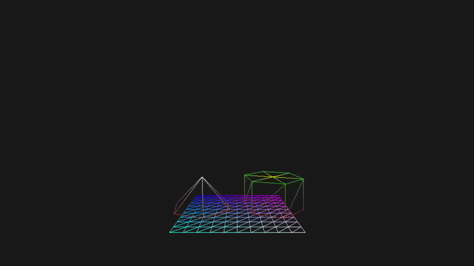
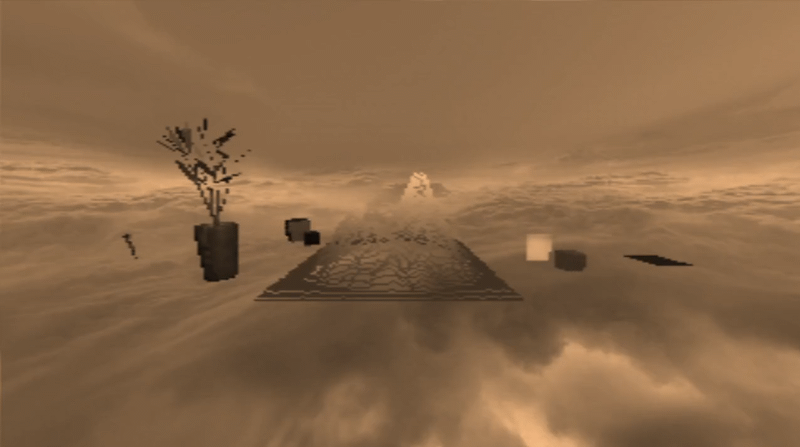

# VS 3D Renderer

A small real-time 3D renderer written from scratch in **C++17 and modern OpenGL 3.3 (Core Profile)**, built step by step as two university assignments for the *Graphics Programming* course (4th year, Game Design & Development, UDIT Madrid).

The repository has two Visual Studio solutions that show the progression from hand-built procedural meshes to a textured, lit scene with a skybox, a heightmap terrain, imported models, fog and a post-processing pass.

| Project | What it shows |
|---|---|
| [`01_Geometric-figures`](docs/01-geometric-figures.md) | Procedural generation of a subdivided plane, cone and cylinder with VAOs/VBOs/EBOs, per-vertex colour and a basic MVP shader. |
| [`02_Scene-render`](docs/02-scene-render.md) | A navigable 3D scene: FPS camera, scene graph, Assimp model loading, textures, Blinn-Phong lighting, distance fog, cube-map skybox, GPU heightmap terrain, alpha blending and an off-screen framebuffer with a sepia post-process. |

<p align="center">
  
  <br><em>01 · Geometric figures</em>
</p>

<p align="center">
  
  <br><em>02 · Scene render</em>
</p>

---

## Features

### 01 · Geometric figures
- **Plane** subdivided into an N×N grid, with a UV-style colour gradient (wireframe).
- **Cone** and **cylinder** generated for any number of slices (`Subdivision(int)`), with indexed triangles for the sides and triangle fans for the caps.
- Continuous rotation driven by a model-view matrix, perspective projection with GLM.

### 02 · Scene render
- **First-person camera**: WASD to move, mouse-look with yaw/pitch and a pitch clamp, toggled with `Esc`.
- **Scene graph** (`SceneNode`) with local transforms passed down the hierarchy, holding polymorphic `Mesh` objects. The animated cubes are nodes too: a spinning cube carries an orbiting child.
- **Model import** via Assimp (`AssimpMesh`): every mesh of a file merged into one VAO, with positions, normals and UVs in separate VBOs.
- **2D textures** loaded with SOIL2, with mipmaps and repeat wrapping.
- **Per-pixel Blinn-Phong lighting** (ambient + diffuse + specular, half-vector) from a point light fixed in world space.
- **Linear distance fog** blended in the fragment shader; fully fogged fragments are discarded.
- **Cube-map skybox** drawn first with depth writes disabled.
- **Heightmap terrain**: a flat grid stored as **half-float** XZ coordinates and displaced on the GPU by sampling a height texture in the vertex shader.
- **Transparency** with `GL_BLEND` and depth writes disabled for the transparent pass.
- **Render-to-texture post-processing**: the scene is drawn into an off-screen framebuffer (colour texture + depth renderbuffer), then drawn to the window on a fullscreen quad with a sepia filter. At runtime, `P` toggles the filter and `R` switches between a 256×256 retro look and the native resolution.
- **Frame-rate independent** camera and animation, driven by the real frame time.

---

## Tech stack

| Library | Use |
|---|---|
| [SDL2](https://www.libsdl.org/) | Window, OpenGL context, input |
| [GLAD](https://glad.dav1d.de/) | OpenGL function loader |
| [GLM](https://github.com/g-truc/glm) | Vectors, matrices, transforms |
| [Assimp](https://github.com/assimp/assimp) | 3D model import (`.obj`) |
| [SOIL2](https://github.com/SpartanJ/SOIL2) | Image and texture loading |
| [half](https://half.sourceforge.net/) | 16-bit floats for compact terrain vertex data |

All dependencies are **included in [`libraries/`](libraries/)** as headers and prebuilt static libraries for **Windows x64 / MSVC v143**, so there's nothing to install.

---

## Quick start

**Requirements:** Windows 10/11 x64, Visual Studio 2022 with the *Desktop development with C++* workload, and a GPU that supports OpenGL 3.3.

```text
1. git clone https://github.com/miguelrg14/VS_3D-Renderer.git
2. Open 02_Scene-render/project/02_Scene-render.sln
   (or 01_Geometric-figures/project/01_Geometric-figures.sln)
3. Select the x64 platform (Debug or Release)
4. Press F5
```

Asset paths are relative (`../assets/...`), so the program must run with `project/` as its working directory. That's Visual Studio's default when you launch with F5.

See **[docs/building.md](docs/building.md)** for full details and troubleshooting.

### Controls (02 · Scene render)

| Input | Action |
|---|---|
| `W` / `S` | Move forward / backward |
| `A` / `D` | Strafe left / right |
| Mouse | Look around |
| `Esc` | Toggle camera mode (releases or captures the mouse) |
| `P` | Sepia post-process on / off |
| `R` | Framebuffer resolution: 256×256 retro / native |
| Close window | Exit |

---

## Repository layout

```text
VS_3D-Renderer/
├── 01_Geometric-figures/
│   ├── code/          # Cone, Cylinder, Plane, Cube, Scene, Window, Main
│   └── project/       # Visual Studio solution and project
├── 02_Scene-render/
│   ├── assets/        # Textures, cube-map faces, height map (+ .obj models)
│   ├── code/          # Renderer sources (see docs/02-scene-render.md)
│   ├── documents/     # Original assignment documentation
│   └── project/       # Visual Studio solution and project
├── libraries/         # Vendored third-party headers + prebuilt static libs
└── docs/              # Technical documentation
```

---

## Documentation

- [01 · Geometric figures](docs/01-geometric-figures.md): mesh generation algorithms
- [02 · Scene render](docs/02-scene-render.md): architecture, frame pipeline, shaders and class reference
- [Building & troubleshooting](docs/building.md)

---

## Credits

- The base framework (`Window`, the original `Scene`/`Cube` skeleton and the shader-compilation helpers) was provided by **Ángel Rodríguez** as course material at UDIT. Files that come from it keep his header.
- Everything else (procedural figures, camera, scene graph, model loading, lighting, fog, terrain, skybox integration, post-processing) was written by **Miguel Rodríguez Gallego**.
- Third-party libraries are distributed under their own licences (see each folder in `libraries/`).

## License

[MIT](LICENSE) © Miguel Rodríguez Gallego
