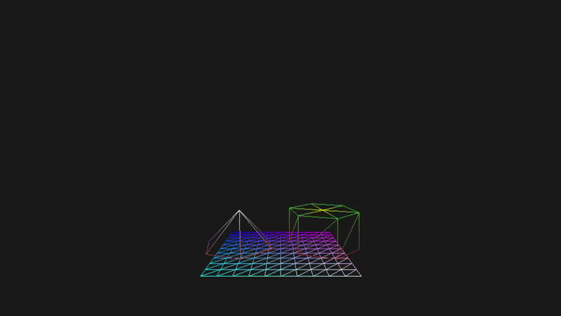
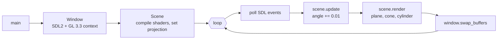

# 01 · Geometric figures

The first assignment: building meshes **procedurally on the CPU**, uploading them into OpenGL buffers and drawing them with a minimal shader. No textures or lighting, just geometry, indices and per-vertex colour.

Solution: `01_Geometric-figures/project/01_Geometric-figures.sln`



---

## Program flow



- Viewport is 1024×576. VSync is on by default (`Window::OpenGL_Context_Settings`).
- `Scene` compiles a single shader program. The vertex shader applies `projection * model_view` and passes the vertex colour through, and the fragment shader outputs it.
- Each object gets its own model-view matrix (a translation, then a rotation driven by `angle`) before its `render()` call.

## Common pattern of every figure

Every figure class follows the same layout:

```cpp
enum { COORDINATES_VBO, COLORS_VBO, INDICES_EBO, VBO_COUNT };
GLuint vbo_ids[VBO_COUNT];
GLuint vao_id;
```

| Attribute location | Data | Format |
|---|---|---|
| `0` | Position | `vec3` float |
| `1` | Colour | `vec3` float |
| EBO | Triangle indices | `GLuint` (`GLubyte` for the cube) |

`Subdivision(n)` rebuilds the vertex, colour and index arrays in `std::vector`s and re-uploads them with `glBufferData(..., GL_STATIC_DRAW)`, so the resolution can be changed at runtime.

---

## Plane: `Plane::Subdivision(int amount)`

Builds an `(amount + 1) × (amount + 1)` vertex grid covering `[-1, 1]` on X and Y at `z = 1`.

- **Vertices:** `x = -1 + 2·i/amount`, `y = 1 - 2·j/amount`
- **Colour:** `(i/amount, j/amount, 1)`, a red/green gradient over blue
- **Indices:** each cell `(topLeft, topRight, bottomLeft, bottomRight)` produces two triangles:
  `TL-BL-TR` and `TR-BL-BR`

Total: `(n+1)²` vertices and `6n²` indices. Rendered in **wireframe** (`glPolygonMode(GL_LINE)`). In the scene it's rotated about −90° on X to act as a floor.

## Cone: `Cone::Subdivision(int slices)`

Radius 1, height 1, base on the XZ plane.

| Index | Vertex |
|---|---|
| `0` | Apex `(0, 1, 0)` |
| `1` | Base centre `(0, 0, 0)` |
| `2 … slices+1` | Base ring: `(cos θ, 0, sin θ)`, `θ = 2π·i/slices` |

- **Sides:** `slices` triangles `(apex, ring[i+1], ring[i])`
- **Base:** a triangle fan `(centre, ring[i], ring[i+1])`
- Colour fades from red to blue around the ring.

Default: 6 slices (a hexagonal pyramid). More slices give a smoother cone.

## Cylinder: `Cylinder::Subdivision(int slices)`

Radius 1, height 1. Minimum 3 slices.

| Index range | Vertex |
|---|---|
| `0 … slices-1` | Bottom ring (`y = 0`), red |
| `slices … 2·slices-1` | Top ring (`y = 1`), green |
| `2·slices` | Bottom centre, yellow |
| `2·slices + 1` | Top centre, yellow |

- **Sides:** two triangles per segment joining the bottom and top rings
- **Caps:** two triangle fans with opposite winding so both face outward

The class still keeps the hard-coded 6-slice arrays and `init()` from an earlier version. The constructor calls `init()` and then `Subdivision(6)`, which overwrites it.

## Cube

The original course example: 8 shared vertices coloured as an RGB cube, 12 triangles with `GLubyte` indices. It's disabled (commented out) in `Scene::render()`.

---

## Render state

- `GL_CULL_FACE` enabled, **`GL_DEPTH_TEST` disabled**, so draw order decides what's visible.
- Clear colour `(0.1, 0.1, 0.1)`.
- Note that `Plane::render()` switches `glPolygonMode` to `GL_LINE` and never switches it back, so every object drawn after it is also wireframe.
