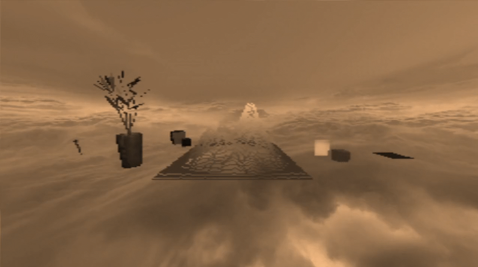
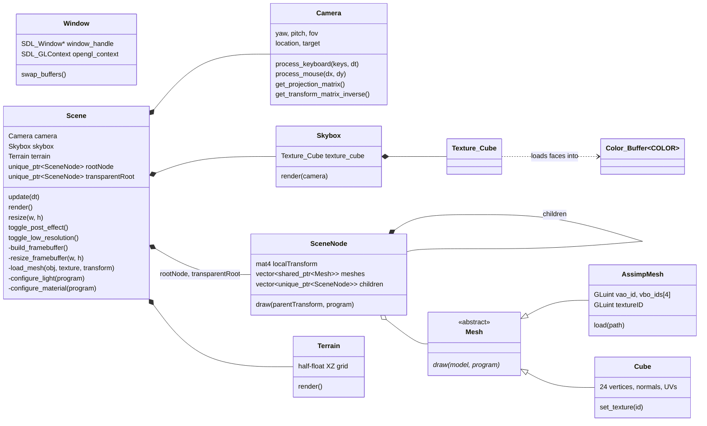
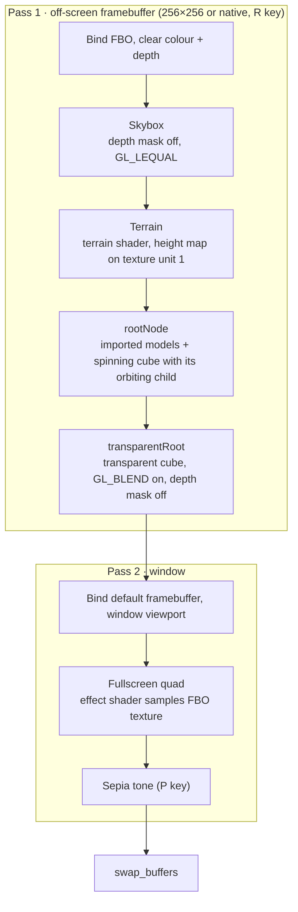

# 02 · Scene render

The final assignment: a navigable 3D scene that combines model loading, texturing, lighting, fog, a skybox, a GPU-displaced terrain, transparency and a post-processing pass.

Solution: `02_Scene-render/project/02_Scene-render.sln`



---

## Architecture



### Module reference

| File | Responsibility |
|---|---|
| `main.cpp` | Creates the `Window` and `Scene`, runs the event loop, forwards mouse and keyboard input to the camera and the post-processing toggles. Measures the real frame time with `SDL_GetPerformanceCounter` (clamped to 0.1 s). |
| `Window.hpp/.cpp` | SDL2 window and OpenGL 3.3 Core context, GLAD initialisation, VSync, buffer swap. Move-only RAII type. |
| `Scene.hpp/.cpp` | Owns every renderable and the shader programs. Builds the framebuffer, loads assets, animates the scene-graph nodes, sets lighting and fog uniforms, and runs the frame pipeline. |
| `Camera.hpp/.cpp` | FPS camera. `yaw`/`pitch` define a front vector, the view matrix comes from `glm::lookAt`, and the projection is `glm::perspective` (FOV 90°, near 0.1, far 1000). Pitch is clamped to ±89°. |
| `SceneNode.hpp` | Scene graph node. `draw()` computes `global = parent × local`, uploads `model_view_matrix` and `normal_matrix`, draws its meshes and recurses into its children. |
| `Mesh.hpp` | Abstract "drawable" interface. The node uploads the matrices; a mesh only binds its texture and draws. |
| `AssimpMesh.hpp/.cpp` | Loads a model with Assimp and merges **all** its triangle meshes into one VAO: positions (loc 0), normals (loc 1), UVs (loc 2, v flipped to match the texture upload) and 32-bit indices. Node transforms are baked in and missing normals are generated. Owns its VAO, VBOs and diffuse texture. |
| `Cube.hpp/.cpp` | A `Mesh`: 24-vertex cube (4 per face) with flat normals and per-face UVs. One instance, textured with `wood.png`, is shared by the three animated cube nodes. |
| `Skybox.hpp/.cpp` | Unit cube with its own shader, sampled from a `samplerCube`. Rendered around the camera. |
| `Texture_Cube.hpp/.cpp` | Loads six images `sky-cube-map-0..5.png` into a `GL_TEXTURE_CUBE_MAP`. |
| `Terrain.hpp/.cpp` | 50×50 grid over 10×10 units, stored as **half-float** XZ positions and UVs (half the memory of `float`). Laid out in a zig-zag and drawn as `GL_LINE_STRIP`. |
| `opengl-recipes.hpp/.cpp` | Shared helpers: `compile_shaders`, error reporting, `load_image<T>` (SOIL2) and `create_texture_2d` (RGBA, mipmaps, `GL_REPEAT`, returns 0 on failure). |
| `Color.hpp`, `Color_Buffer.hpp` | `Rgba8888` / `Monochrome8` pixel formats and a templated 2D pixel buffer used by image loading. |

---

## Frame pipeline



By default the framebuffer is **256×256** and stretched to the window with linear filtering, which gives the output its low-res, retro look. Press **R** to switch it to the window resolution: the colour texture and the depth buffer are re-allocated and stay attached to the framebuffer.

---

## Shaders

All shaders are GLSL 330, embedded as raw string literals in `Scene.cpp` and `Skybox.cpp`.

### Main object shader

**Vertex stage:** transforms the position and the normal to eye space, passes the UVs on and computes the fog factor:

```glsl
fog_factor = clamp((-pos_view.z - fog_near) / (fog_far - fog_near), 0, 1);
```

**Fragment stage: per-pixel Blinn-Phong lighting, texture and fog**

```glsl
N = normalize(view_normal);                    // re-normalised after interpolation
L = normalize(light.position.xyz - view_position);
V = normalize(-view_position);
H = normalize(L + V);

lit = ambient * material
    + diffuse * max(dot(N, L), 0) * light.color * material
    + specular * pow(max(dot(N, H), 0), shininess) * specular_color;
```

Lighting is evaluated **for every pixel**, so highlights are smooth instead of following the triangles.

- `discard` when `fog_factor >= 1`, so objects disappear into the fog
- `rgb = mix(lit * texture.rgb, fog_color, fog_factor)`
- `alpha = texture.a * (0.5 - fog_factor)` (only has a visible effect when blending is on)

**Lighting and fog uniforms**

| Uniform | Value |
|---|---|
| `light.position` | `light_world_position = (10, 20, 10)` in world space, multiplied by the view matrix every frame, so the light stays fixed in the world |
| `light.color` | `(1, 1, 1)` |
| `ambient_intensity` / `diffuse_intensity` | `0.2` / `0.8` |
| `specular_intensity` / `shininess` / `specular_color` | `1.0` / `32` / white |
| `material_color` | `(1, 1, 1)` |
| `fog_near` / `fog_far` / `fog_color` | `30` / `50` / `(0.8, 0.8, 0.9)` |

### Terrain shader

The vertex shader receives only `vec2` XZ and UV, samples the red channel of `height-map.png` and builds the position on the GPU:

```glsl
float h = texture(sampler, uv).r;
gl_Position = projection * model_view * vec4(xz.x, h * max_height, xz.y, 1);
intensity = h * 0.75 + 0.25;   // grey shade by height
```

`max_height = 5`. The fragment shader outputs `intensity` as greyscale.

### Post-process shader

Draws the FBO texture onto a fullscreen quad already in clip space, converts it to luminance and tints it with `vec3(1.0, 0.75, 0.5)` (sepia). The `effect_enabled` uniform, toggled with **P**, shows the original image instead.

---

## Scene contents

| Object | Position | Notes |
|---|---|---|
| Skybox | around the camera | `assets/sky-cube-map-{0..5}.png` |
| Terrain | origin | `assets/height-map.png`, wireframe |
| `Ground.obj` | `(15, 0, 0)` | `Stone_Base_Color.png` |
| `Painting.obj` | `(10, 0, -3)` | `Frame1.jpg` |
| `Plant.obj` | `(-10, -1, 0)` | `plant1_Material.001_BaseColor.png` |
| `Umbrella.obj` | `(-15, 0, 0)` | `Umbrella_DefaultMaterial_BaseColor.png` |
| Spinning cube | `(-10, 0, -10)` | `wood.png`, spins on Y |
| Orbiting cube | child node of the spinning cube, offset `(5, 0, 0)`, scale 0.5 | inherits its parent's spin through the scene graph |
| Transparent cube | `(10, 0, 0)`, scale 0.5 | under `transparentRoot`, drawn in the blended pass |

The cube transforms are set in `Scene::update(dt)`, which writes the `localTransform` of each node.

To add a model, call `load_mesh` in the `Scene` constructor:

```cpp
load_mesh("../assets/MyModel.obj",
          "../assets/MyModel_BaseColor.png",
          glm::translate(glm::mat4(1.0f), glm::vec3(0.0f, 0.0f, 5.0f)));
```

Each call creates an `AssimpMesh`, wraps it in a `SceneNode` with the given local transform and attaches it to `rootNode`. If the model can't be loaded, a `[Scene] skipping model` message appears in Visual Studio's *Output* window and the rest of the scene still loads.

---

## Input

`main.cpp` enables SDL relative mouse mode at startup.

- `SDL_MOUSEMOTION`: `xrel`/`yrel` × `mouseSensitivity (0.1)` go to yaw/pitch
- `SDL_GetKeyboardState`: WASD moves along the camera's forward and right vectors at `movementSpeed = 5` units/s, scaled by the real frame time
- `Esc`: toggles relative mouse mode and stops mouse-look
- `P`: sepia post-process on/off
- `R`: framebuffer resolution 256×256 / native
- Key repeats are ignored, so holding a key toggles it only once
